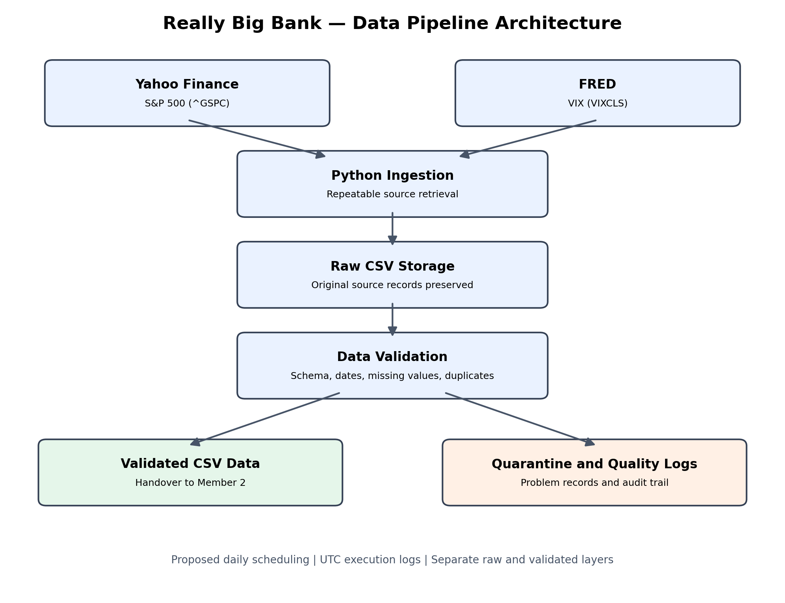

# Really Big Bank — BUSA3022 Analytics Implementation Plan & Portfolio

## Project Overview

This repository supports the BUSA3022 Analytics Lead Case Study for the fictional Really Big Bank.

The project aims to develop a market-intelligence analytics system that helps management answer:

**How has market activity trended over the past 90 days, and is there anything we should be watching?**

The group project has four components:

1. **Data Pipeline:** Financial data ingestion, validation and quality logging.
2. **Data Curation:** Date alignment, financial metrics and transformation.
3. **Dashboard:** A 90-day market overview, macroeconomic comparison and Red/Amber/Green signal.
4. **Presentation and Integration:** Implementation rationale, working demonstrations, AI reflection and leadership considerations.

This is an academic proof of concept, not a production banking system.

## 1. Data Sources

| Dataset | Provider | Identifier | Frequency |
|---|---|---|---|
| S&P 500 Index | Yahoo Finance | `^GSPC` | Daily market observations |
| CBOE Volatility Index (VIX) | FRED | `VIXCLS` | Daily observations |

The S&P 500 represents broad US equity-market performance. VIX provides a forward-looking measure of expected market volatility, rather than historical realised volatility.

Approximately 180 calendar days of source data are requested to support the final 90-day dashboard and rolling calculations.

## 2. Pipeline Architecture



The implemented pipeline follows these stages:

1. Retrieve financial data using Python.
2. Preserve timestamped raw CSV snapshots.
3. Validate required columns and observation values.
4. Separate accepted records from problematic records.
5. Record data-quality events and validation outcomes.
6. Provide validated datasets for downstream processing.

Raw observations are kept separately from transformed data to support reproducibility and investigation.

## 3. Proof-of-Concept Results

**Execution date:** 29 October 2026.

| Dataset | Retrieved | Accepted | Quarantined |
|---|---:|---:|---:|
| S&P 500 | 124 | 124 | 0 |
| VIX | 127 | 127 | 0 |
| **Total** | **251** | **251** | **0** |

Observation coverage:

- S&P 500: 4 May 2026 to 28 October 2026.
- VIX: 4 May 2026 to 27 October 2026.

The latest VIX observation was one day behind the latest S&P 500 observation in this run. Source freshness must therefore be evaluated against publication timing rather than assuming both series update simultaneously.

### Source Verification

The saved data was compared with fresh downloads from the same providers.

- S&P 500: 124 of 124 closing values matched within the comparison tolerance.
- VIX: 127 of 127 observations matched.
- No comparison dates were missing.

These are repeat-download consistency checks, not independent cross-provider verification.

See `docs/source_verification.csv`.

## 4. Data Quality and Failure Handling

The pipeline checks:

- Required column availability.
- Valid observation dates.
- Numeric and positive market-price values.
- Missing required values.
- Duplicate observation dates.

Controlled synthetic tests demonstrated detection of missing values, duplicates, invalid dates and schema changes.

These deliberately introduced problems were test scenarios, not defects found in the live financial downloads.

The pipeline preserves raw data and creates structured quality logs rather than silently discarding invalid observations.

Relevant files:

- `tests/test_pipeline.py`
- `logs/data_quality_log.csv`
- `docs/pipeline_design.md`

## 5. How to Run the Proof of Concept

### Requirements

- Python 3
- Internet connection
- Packages listed in `requirements.txt`

### Local setup

From the repository's root folder, install dependencies:

```bash
python -m pip install -r requirements.txt
```

Run the validation tests:

```bash
python tests/test_pipeline.py
```

Run the pipeline:

```bash
python src/pipeline.py
```

Alternatively, open `notebooks/01_data_pipeline.ipynb` in Google Colab, install the dependencies, and execute the notebook cells using the repository root as the working directory.

The notebook contains the demonstrated live execution and supporting checks.

## 6. Project Files

| Path | Purpose |
|---|---|
| `src/pipeline.py` | Data retrieval and validation logic |
| `tests/test_pipeline.py` | Synthetic failure tests |
| `notebooks/01_data_pipeline.ipynb` | Executed notebook and verification evidence |
| `data/raw/` | Original timestamped source snapshots |
| `data/validated/` | Accepted datasets |
| `data/quarantine/` | Rejected records, when produced |
| `logs/data_quality_log.csv` | Structured execution and quality events |
| `diagrams/pipeline_architecture.png` | Pipeline architecture diagram |
| `docs/pipeline_design.md` | Design decisions and limitations |
| `docs/source_verification.csv` | Repeat-download comparison results |
| `docs/ai_verification_log.md` | AI-assisted coding issue and correction |
| `docs/handover_member2.md` | Downstream handover instructions |

## 7. Handover to Member 2

The data-curation team should begin with:

- `data/validated/market_validated.csv`
- `data/validated/macro_validated.csv`

Market fields:

`date`, `adj_close`, `close`, `high`, `low`, `open`, `volume`

Macro fields:

`date`, `vix`

Both series use US observation dates. Dates should be aligned explicitly, without arbitrarily shifting observations according to the Australian execution timezone.

Do not invent missing observations or assume every calendar date represents a trading day.

Member 2 has added a reproducible data-curation proof of concept (three calculated metrics, date alignment and an audit log). See [Part 2 technical documentation](part2_data_curation/README.md).

See `docs/handover_member2.md`.

## 8. AI Use and Verification

ChatGPT assisted with code development, testing guidance and documentation.

One genuine AI-assisted error occurred during source verification: an attempted pandas merge used incompatible date-column types (`object` and `datetime64[ns]`).

The error was detected through the Python traceback, corrected through consistent datetime conversion, and followed by successful comparison of all 124 S&P 500 closing values.

This error occurred in the verification script, not the underlying ingestion pipeline.

AI-generated code requires human review, controlled tests, source checks and documented corrections before it is accepted.

See `docs/ai_verification_log.md`.

## 9. Proposed Operations and Limitations

Daily GitHub Actions scheduling is proposed but has **not been deployed**.

The current working proof of concept was executed manually using Google Colab.

Further production requirements would include automated monitoring, retries, atomic writes, controlled releases, access management and clear responsibility for failed runs.

Validated CSV files currently represent latest-run snapshots, not a managed production data warehouse.

## 10. Group Collaboration

The four group members are responsible for:

- Member 1: Pipeline and source validation.
- Member 2: Data curation and calculated metrics.
- Member 3: Dashboard and reporting.
- Member 4: Presentation, integration and final consistency checks.

The technical components should retain consistent source identifiers, column definitions, observation-date conventions and documented assumptions.

Changes to shared data contracts should be discussed and recorded before downstream files are modified.

## Academic Note

This repository contains academic proof-of-concept work. Any generative-AI-produced text used in the assessed submission must be attributed in accordance with the revised assignment brief and the university's academic-integrity requirements.

## 11. Part 2 — Data Curation (Added to the Group Repository)

Part 2 now uses the **existing Part 1 validated CSVs**. It does not change the Part 1 pipeline or its raw/validated source files. See [`part2_data_curation/README.md`](part2_data_curation/README.md) for formulas, data definitions, date/time-zone decisions, limitations and traceable evidence.

**Metrics:** 20-market-session S&P 500 simple moving average, one-session return (%), and annualised 14-return historical volatility (%). VIX (`VIXCLS`) is kept as a separately observed expected-volatility index, not mislabelled as a historical realised-volatility measure.

**Re-run from this repository root:**

```bash
python -m pip install -r requirements.txt
python -m unittest discover -s part2_data_curation/tests -v
python part2_data_curation/curation.py \
  --sp500 data/validated/market_validated.csv \
  --vix data/validated/macro_validated.csv \
  --out part2_data_curation/real_outputs
```

**Current saved-snapshot result (29 October 2026):** 124 S&P 500 sessions, 127 VIX records, 123 dates in common, 1 missing same-day VIX value (28 October), 4 additional VIX-only dates retained in the audit, and 0 newly quarantined source records. **Six Part 2 automated checks pass.** These results are derived from the repository's saved files, not a fresh download.

**Handover for Part 3:** `part2_data_curation/real_outputs/curated_sp500_vix.csv`, with `vix_gap_flag` for unavailable macro values. Review `quality_log.csv`, `vix_only_dates.csv`, and the curated-data definitions before developing the dashboard.

**Google Colab:** Open [`Part2_Data_Curation_Colab.ipynb`](part2_data_curation/Part2_Data_Curation_Colab.ipynb). The notebook supports running inside the repository or uploading a ZIP containing the complete merged repository and validated data files.

