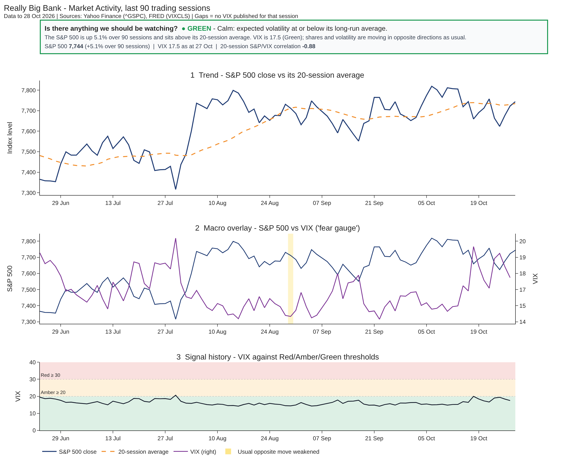

# Really Big Bank — BUSA3022 Analytics Implementation Plan & Portfolio

## 3. Dashboard and Reporting Plan

This folder contains Part 3 of the Really Big Bank market-intelligence proof of concept. It turns the **curated** S&P 500 (`^GSPC`) and CBOE VIX (`VIXCLS`) dataset from Part 2 into a single dashboard view, without changing the Part 2 files. The dashboard answers the business question: **How has market activity trended over the past 90 days, and is there anything we should be watching?**



### 3.1 Audience and Design Approach

The audience is **financially literate but non-technical** managers. The dashboard is one page, read from top to bottom like a story:

| Order | Section | What it shows | Why it is there |
|---|---|---|---|
| 1 | **Headline signal** | Red/Amber/Green status, one plain-English sentence and key figures | A reader who stops here still gets the answer |
| 2 | **Trend** | S&P 500 close for the **past 90 calendar days** with the Part 2 20-session moving average (SMA20) | Shows the market's direction; a close below the average is an early sign of weakening momentum |
| 3 | **Macro overlay** | S&P 500 (blue, left axis) and VIX (purple, right axis) on the same chart | Shows whether shares and expected volatility are still moving in opposite directions |
| 4 | **Signal history** | VIX against the Red/Amber/Green bands | Shows how today's signal was reached and how often it has changed |

**Window and session conventions.** The display window is the **past 90 calendar days** (the brief asks about "the past 90 days"), counted back from the latest S&P 500 session. The SMA20 and the correlation still count **trading sessions** and are calculated on the full history before the window is applied, so the first day shown already has complete 20-session values. The 90-day change is measured from the last close on or before the window start.

Candlesticks, trading volume, technical indicators and jargon were **deliberately left out** because they add detail without answering the question. Every colour is paired with a status word so the dashboard also works for colour-blind readers and in black-and-white print.

The wireframe (`wireframe.png`) is the design portfolio artifact; values in [brackets] are placeholders that the working dashboard fills in.

### 3.2 Trend and Macro Overlay

VIX normally moves **opposite** to shares: when the S&P 500 rises, VIX usually falls (Hartford Funds, 2026).

**Correlation warning rule.** For every session, the dashboard calculates the correlation between daily S&P 500 % returns and daily VIX % changes over the **last 20 trading sessions**. At least 15 sessions with both values are required, so a single missing VIX day does not blank the measure. A day is shaded yellow when the correlation is **above −0.30** (strictly greater). An absolute correlation below 0.30 is weaker than Cohen's (1988) "medium" benchmark, i.e. the usual opposite relationship has become weak.

| Correlation | Meaning | Shown as |
|---|---|---|
| −1 to −0.30 | Normal pattern: shares and VIX move in opposite directions | No shading |
| Above **−0.30** | Usual pattern has weakened (divergence) | Yellow shading on the overlay chart |

Because the two lines use different scales, the chart tells readers to compare the **directions** of the lines, not where they cross. Price axes are zoomed to the data range (not from zero); this is stated under the dashboard title.

Missing VIX sessions are **not filled in**. They appear as gaps in the line, consistent with the Part 2 `vix_gap_flag` rule.

### 3.3 Red/Amber/Green Signal and Threshold Justification

The signal uses the **latest available VIX close**, because VIX is forward-looking and suits the question "is there anything we should be watching?".

| Status | Rule | Meaning | Justification |
|---|---|---|---|
| **Green** | VIX < 20 | Calm | VIX averaged 18.93 in 2025 and about 18.10 so far in 2026 (MacroTrends, n.d.); below 20 "generally indicates investor contentment" (Hartford Funds, 2026) |
| **Amber** | 20 ≤ VIX < 30 | Above normal — monitor daily | Expected volatility above its long-run average |
| **Red** | VIX ≥ 30 | Stress — escalate | Above 30 "suggests anxiety" (Hartford Funds, 2026) |
| **Grey** | Latest VIX missing, or more than 3 sessions old (4+) | Data issue — do not rely on the signal | Prevents an out-of-date reading showing a false Green |

All thresholds sit in **one configuration block** at the top of `part3_dashboard.py`, so they can be reviewed against the bank's risk appetite without touching chart code.

### 3.4 Working Proof of Concept

The saved outputs were generated from the actual **Part 2 curated snapshot** (`part2_data_curation/real_outputs/curated_sp500_vix.csv`), not new provider downloads.

| Evidence | Verified result |
|---|---:|
| Display window | Past 90 calendar days: 31 Jul – 28 Oct 2026 (63 trading sessions) |
| Latest S&P 500 close (28 Oct 2026) | 7,743.98 |
| 90-day change (from 30 Jul 2026 close of 7,437.63) | +4.1% |
| 90-day high / low close | 7,818.93 (6 Oct) / 7,489.72 (31 Jul) |
| Latest SMA20 | 7,734.34 (close is above it) |
| VIX range in window | 14.21 (22 Sep) – 19.99 (16 Oct) |
| Latest VIX (27 Oct 2026) | 17.52 |
| **Latest signal** | **Green** |
| Signal history in window | 63 Green, 0 Amber, 0 Red, 0 Grey |
| Latest 20-session S&P 500 / VIX correlation | −0.88 |
| Correlation range in window | −0.96 to −0.27 |
| Divergence sessions shaded yellow | 1 (28 Aug 2026, correlation −0.27) |
| Sessions missing VIX | 1 (28 Oct 2026, left blank) |
| Automated Part 3 tests passed | 19 |

#### What the dashboard shows

- **S&P 500 trend:** up 4.1% over the past 90 days to 7,744. It peaked at 7,819 on 6 October, dipped to about 7,550 in mid-September, and now sits just above its 20-session average.
- **VIX movement:** calm throughout, between 14.2 and 20.0. VIX rose from around 15 in early October to 19.99 on 16 October (0.01 below Amber) and has since eased to 17.52.
- **Correlation / divergence:** shares and VIX mostly moved in opposite directions (−0.88 now). The relationship weakened briefly on 28 August (−0.27), the only yellow day.
- **What the signal means:** Green — markets expect normal-sized moves. The mid-October rise in VIX to just under 20 is the main thing worth watching.

Note: the 29 Jul 2026 Amber reading (VIX 20.66) falls just outside the 90-day window, so it is not shown.

The tests check the Green/Amber/Red boundaries (19.99, 20, 29.99, 30), Grey for missing or stale VIX (3 vs 4 sessions old), the 90-calendar-day window, SMA20 using trading sessions, the 90-day change baseline, the −0.30 shading boundary (−0.31, −0.30, −0.29), one-day shading width, schema failure, loading the real Part 2 file and written outputs. Full results: `outputs/test_results.txt`.

**Run from the group repository root:**

```bash
python -m pip install -r part3_dashboard/requirements.txt
python -m pytest -v part3_dashboard/tests
python part3_dashboard/part3_dashboard.py \
  --curated part2_data_curation/real_outputs/curated_sp500_vix.csv
```

To rebuild the inputs directly from Yahoo Finance and FRED instead (internet required), use `python part3_dashboard/part3_dashboard.py --fetch`.

Alternatively, run `Part3_Dashboard.ipynb` in Google Colab. Files used for the proof of concept:

| File / folder | Purpose |
|---|---|
| `part3_dashboard.py` | Signal rules, correlation, chart building and run log |
| `Part3_Dashboard.ipynb` | Executable notebook demonstration |
| `tests/test_part3_dashboard.py` | Nineteen automated tests |
| `outputs/test_results.txt` | Saved test run (evidence) |
| `wireframe.png` / `wireframe.html` | Dashboard wireframe (portfolio artifact) |
| `outputs/dashboard.html` | Interactive dashboard (hover shows exact values) |
| `outputs/dashboard_screenshot.png` | Static image of the dashboard used in the report |
| `outputs/rag_signal_history.csv` | Signal status for every session shown |
| `outputs/dashboard_log.csv` | Structured, UTC-stamped run log |
| `requirements.txt` | Part 3-specific Python dependencies |

### 3.5 AI Agent Lens and Leadership

Claude (Anthropic, 2026) assisted with the dashboard code. AI-assisted code was accepted only after the **rendered dashboard was checked against the data**, not merely because it executed.

| # | Problem found | How it was caught | Correction |
|---|---|---|---|
| 1 | Red/Amber/Green bands on the VIX chart did not appear | Visual check of the rendered chart | Chart drawing order changed; bands drawn with explicit axis references |
| 2 | 28 Aug 2026 (correlation −0.27) should have been shaded yellow but was not | Comparing the chart with `rag_signal_history.csv` | A one-day band had zero width; bands now padded by half a day each side. Test added that fails on the old code and passes now |
| 3 | First drafts used jargon, unrounded axes and colour-only status | Review against the audience | Prompt revised: plain words, rounded numbers, one headline box, a status word beside every colour |
| 4 | AI-built first version showed the last 90 **trading sessions** (about four months), not the past 90 **days** the brief asks for | Team peer review against the brief | Window changed to 90 calendar days (SMA20 and correlation still use trading sessions); tests added for the window, SMA20 and 90-day change |
| 5 | Chart 2 could be misread (crossing lines on two scales) and the −0.30 rule had no stated source | Team peer review | Colour-coded axis titles, "compare directions, not crossings" note, zoomed-axis note; rule justified with Cohen (1988) and boundary tests added |

To help analysts present a clear message, the team should use a shared template: **state the question, give the answer first, use one chart per point and label anything unusual**. Before release, a non-technical colleague should be able to repeat the main message in one sentence. Changes to thresholds or AI-assisted code require peer review and rerunning the tests. This is a limited proof of concept, not a production trading or banking decision engine.

